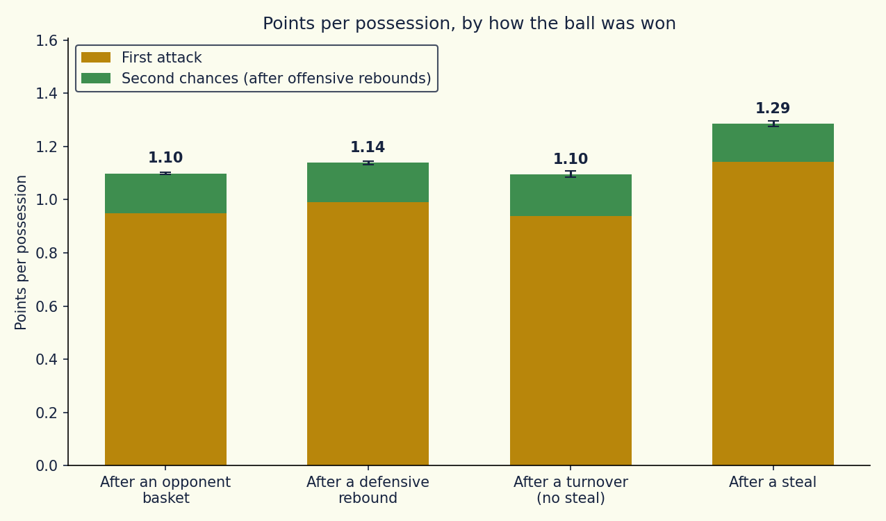
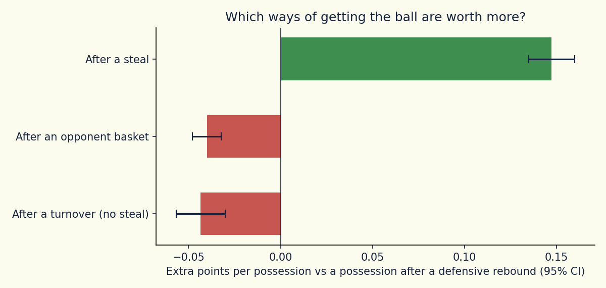
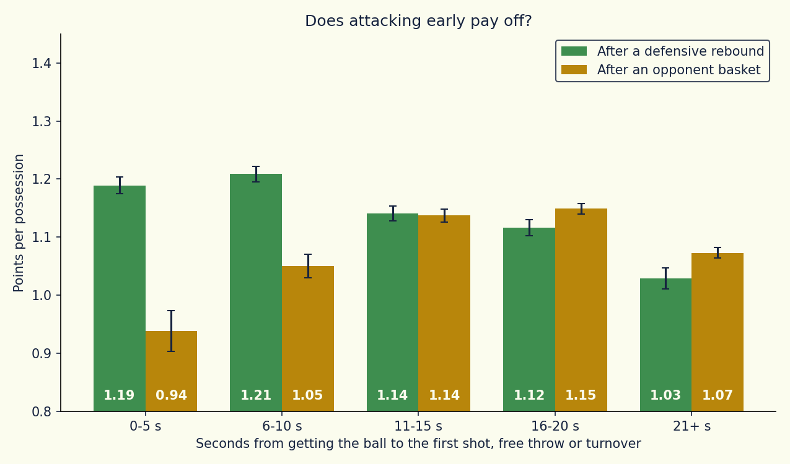
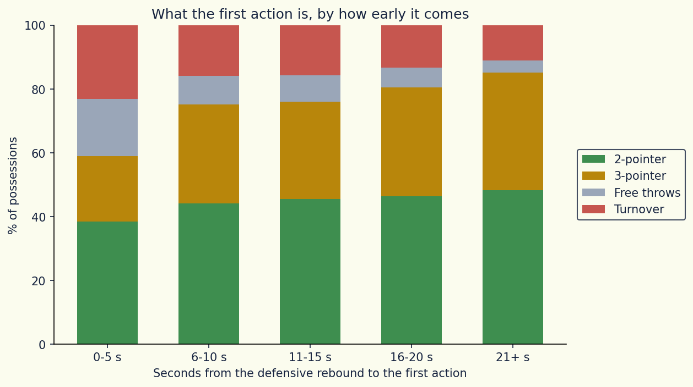

# EuroLeague Possession Value

Rebuilds every possession of 11 EuroLeague seasons (2015-16 to 2025-26) from the play-by-play log, and measures how many points a possession produces depending on how the team got the ball and how early it attacks.

**[Read the brief report](https://htmlpreview.github.io/?https://github.com/viare21/euroleague-possession-value/blob/main/report.html)** for the findings and their interpretation. This README documents how the code works.

## Results in brief

- A possession that starts with a steal produces **1.29** points, against **1.14** after a defensive rebound and **1.10** after an opponent basket
- After a defensive rebound, the best result comes when the first action arrives **6-10 seconds** after the rebound (1.21 points per possession)
- The speed result is descriptive, not causal (see [Limitations](#limitations))

## Data

Source: [Euroleague & Eurocup Datasets](https://www.kaggle.com/datasets/babissamothrakis/euroleague-datasets) (Kaggle). Two files are used.

| File | Columns used | Purpose |
|---|---|---|
| `euroleague_play_by_play.csv` | `game_id`, `season_code`, `number_of_play`, `quarter`, `team_id`, `play_type`, `marker_time` | Ordered log of every event of every game. `marker_time` is the time left in the period |
| `euroleague_header.csv` | `game_id`, `team_id_a`, `team_id_b`, `score_a`, `score_b` | Who plays whom (to find the opponent of each event) and the official final scores (for validation) |

Scope: seasons `E2015` to `E2025`, 3,298 games, about 1.7 million events.

## Project structure

```
euroleague-possession-value/
├── possession_builder.py            # shared logic, imported by the two scripts below
├── possession_value_analysis.py     # analysis 1: points per possession by origin
├── possession_timing_analysis.py    # analysis 2: points per possession by speed of the attack
├── images/                          # charts, created on the first run
└── README.md

csv_euroleague/                      # next to the project folder
├── euroleague_play_by_play.csv
└── euroleague_header.csv
```

| File | What it does |
|---|---|
| `possession_builder.py` | Reads the play-by-play and splits every game into possessions. Exposes `build_segments(pbp, header)` and `possession_table(segments)`. It is not run on its own |
| `possession_value_analysis.py` | Validates the reconstruction, then computes points per possession by how the ball was won, the premium over a defensive-rebound possession, and the value of an offensive rebound |
| `possession_timing_analysis.py` | Measures the seconds between getting the ball and the first action, and the points per possession for each speed |

The three `.py` files must be in the same folder.

## How it works

### 1. Segments and possessions (`possession_builder.py`)

The play-by-play does not mark possessions, so they are reconstructed. The log is read **event by event**, in order, keeping track of one state: which team has the ball and how it got it. A **segment** starts when a team gets the ball and ends when the other team gets it. Every segment gets an `origin`:

| Origin | The team gets the ball by |
|---|---|
| `after_score` | Inbound after an opponent basket or after the last made free throw of a trip |
| `def_rebound` | A defensive rebound (`D`) |
| `off_rebound` | An offensive rebound (`O`): it opens a new segment inside the same possession |
| `steal` | A turnover (`TO`) followed by a steal (`ST`) of the other team |
| `turnover_other` | A turnover with no steal (out of bounds, travel, offensive foul) |
| `unknown` | Start of a period, technical or unsportsmanlike fouls, or an action by a team that does not hold the ball in our state |

How each event updates the state:

| Event (`play_type`) | Effect |
|---|---|
| Made field goal (`2FGM`, `3FGM`, `LAYUPMD`, `DUNK`) | Points go to the current segment. The ball passes to the opponent (`after_score`) |
| Missed field goal (`2FGA`, `3FGA`, `LAYUPATT`, `2FGAB`, `3FGAB`) | The team keeps the ball until a rebound arrives |
| `D` | The rebounding team starts a `def_rebound` segment |
| `O` | The rebounding team starts an `off_rebound` segment, linked to the possession that missed |
| `TO` | The opponent gets the ball. If an `ST` by the opponent appears in the next 3 events, the origin is `steal`, otherwise `turnover_other` |
| `FTM` / `FTA` | A made free throw adds 1 point. If it is the last of the trip and made, the ball passes to the opponent |
| `BP`, `EP`, `EG` | The state is reset |

Details that matter:

- **Offensive rebounds do not create a new possession.** Each segment has a `root`, the first segment of its possession. `possession_table()` sums the points of all segments with the same root, so second chance points are credited to the possession that missed first. `first_attack` is the points of the root segment, `second_chance_points` the rest.
- **Last free throw of a trip.** The code looks at the next relevant event, skipping `IN`, `OUT`, `AS`, `RV`, `CM`, `TOUT`, `TOUT_TV`, `CCH`, `FV`, `AG`. If it is another free throw by the same team in the same quarter, the trip is not over.
- **And-one.** A free throw right after a made field goal is credited to the scorer's own segment, because the ball has already been handed over in the state.
- **Technical and unsportsmanlike fouls** (`CMT`, `CMU`, `CMD`, `CMTI`, `C`, `B`, `F`, `BF`) set a flag: the current segment is relabelled `unknown` and the free throws that follow do not hand over the ball.
- **Empty segments.** A segment is created as soon as a team gets the ball. If the team never acts (for example, an and-one makes the handover happen twice), the segment has `actions == 0` and is dropped by `possession_table()`.
- **Steal order.** In the log the steal is written right after the turnover, so the lookahead only goes forward.

### 2. Time (`seconds_to_first_action`)

`marker_time` is the time left in the period, so it counts down. For each segment the builder stores the clock at the moment the team gets the ball (`start_clock`) and at its first action, which is the first shot, free throw or turnover (`first_action_clock`). The result is:

```
seconds_to_first_action = start_clock - first_action_clock
```

It is set only when both readings exist and the difference is not negative.

### 3. Analysis 1: value by origin (`possession_value_analysis.py`)

1. Load the two CSVs for seasons E2015-E2025, sort by `game_id` and `number_of_play`
2. Build segments and possessions
3. Run the validation checks (next section)
4. Drop `unknown` and `off_rebound` roots. For each remaining origin compute the number of possessions, the mean points split in first attack and second chances, and the 95% confidence interval (`1.96 * std / sqrt(n)`)
5. Take the `def_rebound` possession as reference and compute the premium of the other origins, with the standard errors of the two means combined: `1.96 * sqrt(se_a^2 + se_ref^2)`. The same premium is computed season by season
6. Compute the value of an offensive rebound as the mean points scored by `off_rebound` segments, until the ball is lost

### 4. Analysis 2: speed of the attack (`possession_timing_analysis.py`)

1. Build the possessions as above and keep those that start with a `def_rebound` or an `after_score`. Steals are left out on purpose, because they are almost always immediate fast breaks
2. Keep possessions with a valid `seconds_to_first_action` of at most 30 seconds (beyond that the clock reading is not trustworthy: the shot clock is 24 seconds)
3. Remove possessions where the clock forces the pace: the last 24 seconds of any period, and the last 2 minutes of the 4th quarter and overtime
4. Group by seconds to the first action: 0-5, 6-10, 11-15, 16-20, 21+
5. For each group: share of possessions, points per possession and 95% confidence interval
6. For possessions after a defensive rebound: classify the first action (2-pointer, 3-pointer, free throws, turnover) and count it by speed. Layups and dunks are logged as two-pointers in these seasons
7. Compare fast (0-10 s) and slow (16+ s) possessions season by season

## Data quality checks

Run at the start of `possession_value_analysis.py`:

| Check | Result |
|---|---|
| Points rebuilt from the play-by-play equal the official final score of the team in the game | **100%** of 6,596 team-games |
| Possessions per team per game (a possession includes its second chances) | **71.5**, in line with the ~72 estimated from the box score |
| Share of possessions classified `unknown` and excluded | 4.6% |

The first check is the one that caught a past error: an earlier version credited second chance points to a separate segment and the possession totals were too low.

## Outputs

Charts are saved in `images/`. Each script also prints its tables in the console.



`points_by_possession_origin.png`: points per possession by origin, first attack and second chances.



`premium_vs_defensive_rebound.png`: extra points compared with a possession that follows a defensive rebound, with 95% confidence intervals.



`points_by_speed_of_attack.png`: points per possession by seconds to the first action, after a defensive rebound and after an opponent basket.



`first_action_by_speed.png`: type of the first action (2-pointer, 3-pointer, free throws, turnover) by speed, after a defensive rebound.

## How to run

1. Download the Kaggle dataset and put the CSVs in a `csv_euroleague` folder next to the project folder. If your layout is different, change `DATA_DIR` at the top of each script
2. Install the dependencies: `pip install pandas numpy matplotlib`
3. Run `possession_value_analysis.py` and `possession_timing_analysis.py`. Each one runs on its own and takes under a minute, mostly to rebuild the possessions from about 1.7 million events

In Spyder, run the whole file with F5 and check that the working directory is the project folder, otherwise `possession_builder` cannot be imported. If `__file__` is not defined (cell-by-cell execution), the scripts fall back to the current working directory.

## Limitations

- **Reconstruction rules.** The possessions are inferred from the log, not recorded. They reproduce the official scores exactly, but the rules (steal detection, last free throw, special fouls) are heuristics, and 4.6% of possessions are left out
- **Not causal.** Slow possessions are often the ones where no good shot appears and the clock runs. The data cannot separate "attacking early produces more points" from "good situations lead to early shots"
- **Confidence intervals** assume independent possessions. Possessions of the same game are correlated, so the intervals are approximate
- **Shots.** Player positions and the distance of the defender are not available, so the analysis tells apart only two-pointers and three-pointers. It could be extended using the coordinates of each shot, comparing possessions of different speed within the same shot zone (paint, mid-range, three-point), to check how much of the early advantage depends on easier shot locations

## Tools

Python, pandas, numpy, matplotlib
