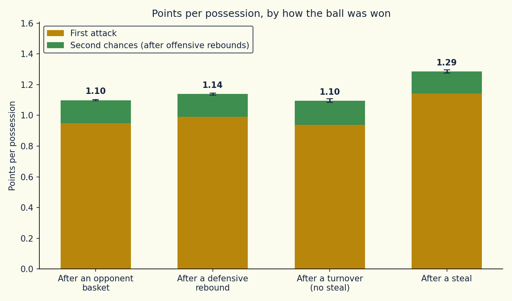
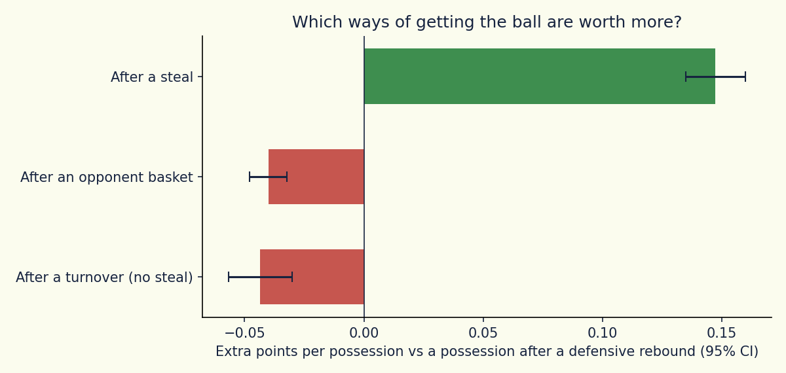
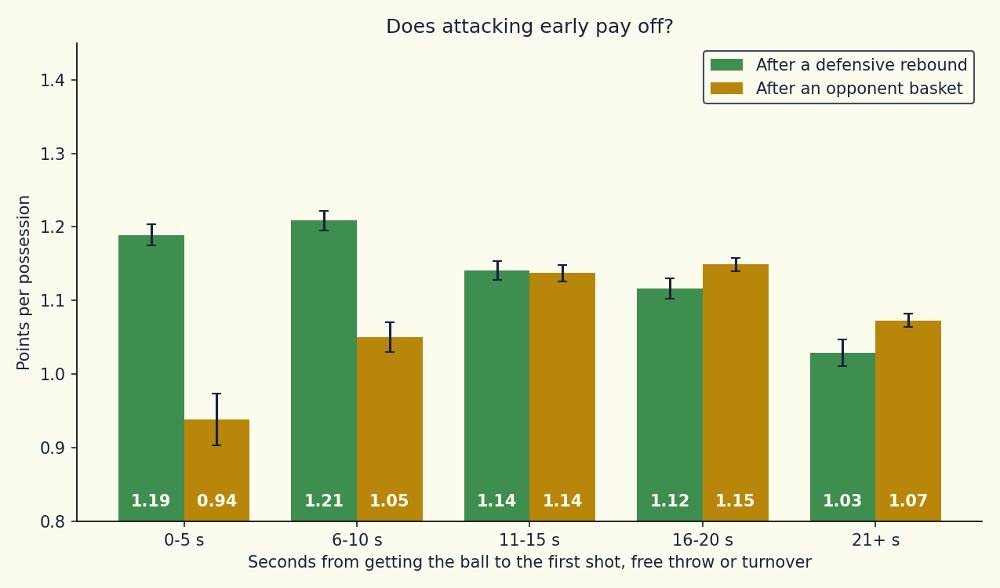
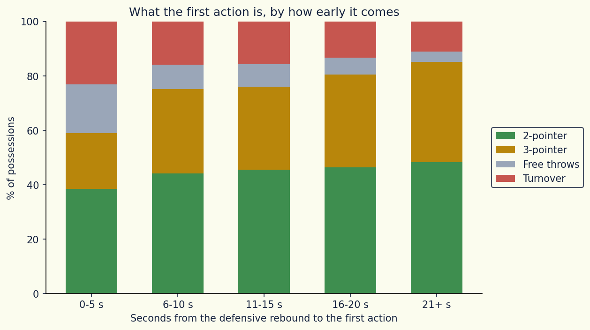

# EuroLeague Possession Value

How many points is a possession worth, depending on how the team got the ball and how fast it attacks? This project rebuilds every possession of 11 EuroLeague seasons from the play-by-play log and measures it.

**Scope:** 3,298 EuroLeague games, seasons 2015-16 to 2025-26, about 471,000 possessions.

## Questions

1. **Value by origin.** A possession can start after an opponent basket, a defensive rebound, a steal, or a turnover without a steal. How many points does each one produce, second chances included?
2. **Speed of the attack.** After a defensive rebound, does it pay to shoot early? How many points does a possession produce depending on the seconds that pass before the first shot, free throw or turnover?

## Data

[Euroleague & Eurocup Datasets](https://www.kaggle.com/datasets/babissamothrakis/euroleague-datasets) (Kaggle). Two files are used:

- `euroleague_play_by_play.csv`: every event of every game, in order, with the time left in the period
- `euroleague_header.csv`: game metadata (teams, final scores)

## How possessions are rebuilt

The play-by-play does not mark possessions, so they are reconstructed from the sequence of events. A **segment** starts when a team gets the ball and ends when the other team gets it. Each one is labelled by how the team got the ball:

| Origin | Starts with |
|---|---|
| `after_score` | Inbound after an opponent basket or a last made free throw |
| `def_rebound` | Defensive rebound |
| `steal` | Opponent turnover followed by a steal |
| `turnover_other` | Opponent turnover without a steal (out of bounds, travel, offensive foul) |
| `off_rebound` | Offensive rebound (continues the possession that missed) |
| `unknown` | Start of a period, technical or unsportsmanlike fouls, anything that cannot be classified |

An offensive rebound is not a new possession: the points scored after it are credited to the possession that created it. The last free throw of a trip is detected by looking at the next relevant event. An and-one free throw is credited to the shot that created it.

**Checks:**

- Points rebuilt from the play-by-play match the official final score in **100%** of the 6,596 team-games
- Possessions per team per game: **71.5**, in line with the ~72 estimated from the box score
- **4.6%** of possessions cannot be classified and are excluded

## Results

### 1. Points per possession, by how the ball was won

| Origin | Possessions | First attack | Second chances | Total |
|---|---|---|---|---|
| After a steal | 41,080 | 1.14 | 0.15 | **1.29** |
| After a defensive rebound | 149,075 | 0.99 | 0.15 | **1.14** |
| After an opponent basket | 219,985 | 0.95 | 0.15 | **1.10** |
| After a turnover (no steal) | 38,606 | 0.94 | 0.16 | **1.10** |

Compared with a possession that follows a defensive rebound:

| Origin | Extra points per possession (95% CI) |
|---|---|
| After a steal | +0.15 (±0.01) |
| After an opponent basket | -0.04 (±0.01) |
| After a turnover (no steal) | -0.04 (±0.01) |

The steal premium is positive in all 11 seasons, between +0.11 and +0.22. Second chances add about 0.15 points to every kind of possession, so they do not change the comparison.





An offensive rebound is an extra attack inside the same possession: the team scores **1.07** points on average from the rebound until it loses the ball (95% CI ±0.01).

The direction of these results is what any coach expects. What the data adds is the size: a steal is worth about 0.15 points more than a defensive rebound, and a dead-ball turnover is not a gift to the other team.

### 2. Speed of the attack after a defensive rebound

Seconds from the defensive rebound to the first shot, free throw or turnover:

| Seconds | Share of possessions | Points per possession | First action is a turnover |
|---|---|---|---|
| 0-5 | 17.7% | 1.19 | 23.1% |
| 6-10 | 24.0% | **1.21** | 15.8% |
| 11-15 | 24.8% | 1.14 | 15.8% |
| 16-20 | 20.9% | 1.12 | 13.2% |
| 21+ | 12.7% | 1.03 | 11.1% |





- Attacking early pays off, but the best bucket is 6-10 seconds, not the fastest one. In the first 5 seconds, almost 1 possession in 4 starts with a turnover.
- The gap between fast possessions (0-10 s) and slow ones (16+ s) is positive in every season, between +0.08 and +0.15 points per possession.
- After an **opponent basket** the picture is different. A possession whose first action comes within 10 seconds produces **1.02** points on average (0.94 in the first 5 seconds, 1.05 between 6 and 10), against **1.14** when the first action comes between 11 and 20 seconds. The defence is already set, so hurrying brings no advantage.

Possessions in the last 24 seconds of a period and in the last 2 minutes of the 4th quarter and overtime are excluded, because the clock or intentional fouls force the pace there.

## Limitations

- **Not causal.** Slow possessions are often the ones where no good shot appears and the clock runs. The data cannot separate "attacking early produces more points" from "good situations lead to early shots".
- Player positions and the distance of the defender are not available, so the analysis tells apart only two-pointers and three-pointers. It could be extended using the coordinates of each shot, comparing possessions of different speed within the same shot zone (paint, mid-range, three-point), to check how much of the early advantage depends on easier shot locations.
- The possession rules are a reconstruction. They reproduce the official scores exactly, but 4.6% of possessions (technical fouls, period starts) are left out.
- Layups and dunks are logged as two-pointers in these seasons.

## Project structure

```
euroleague-possession-value/
├── possession_builder.py            # shared logic: rebuilds possessions from the play-by-play
├── possession_value_analysis.py     # analysis 1: points per possession by origin
├── possession_timing_analysis.py    # analysis 2: points per possession by speed of the attack
├── images/                          # charts, created by the two analysis scripts on the first run
└── README.md

csv_euroleague/                      # CSVs, in a folder next to the project folder
├── euroleague_play_by_play.csv
└── euroleague_header.csv
```

`possession_builder.py` is imported by the two analysis scripts and is not run on its own. **The three .py files must be in the same folder.** Each analysis script can be run independently and takes about 20 seconds.

## How to run

1. Download the Kaggle dataset and place the CSVs in a `csv_euroleague` folder next to the project folder (adjust `DATA_DIR` at the top of each script if your layout is different)
2. Install the dependencies: `pip install pandas numpy matplotlib`
3. Run `possession_value_analysis.py` and `possession_timing_analysis.py`. Charts are saved in `images/`

## Tools

Python, pandas, numpy, matplotlib
